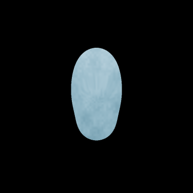
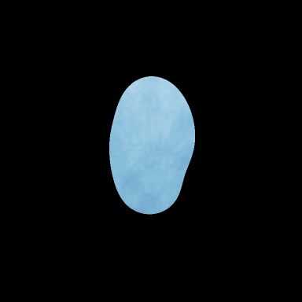

<h1 align="center">ZORG Animation Engine</h1>

<p align="center">
  <strong>MATHEMATICS IN MOTION.</strong><br>
  <em>Open-source research in procedural geometry, bounded motion, and reproducible animation.</em>
</p>

<p align="center">
  <a href="https://github.com/dfeen87/ZORG-Animation-Engine/actions/workflows/ci.yml"></a>
  
  
  
  <a href="LICENSE"></a>
</p>

<p align="center">
  <a href="#overview">Overview</a> ·
  <a href="#see-the-math-in-motion">Visual evidence</a> ·
  <a href="#run-the-interactive-laboratory">Get started</a> ·
  <a href="#reproduce-and-verify">Reproducibility</a> ·
  <a href="#research-roadmap">Roadmap</a> ·
  <a href="#open-science-and-contributions">Open science</a>
</p>

---

## Overview

**ZORG Animation Engine** is an experimental, local-first Python engine for exploring how mathematical fields, numerical dynamics, and programmable direction can generate evolving visual forms.

Instead of assembling animated figures from prerecorded sprites, its current pipeline evaluates mathematical geometry, advances explicitly bounded simulation state, and renders reproducible frames. The research spans **procedural shape construction, deterministic motion, mathematical morphing, interactive control, and evidence-backed visual export**.

ZORG has a creative origin, but it is **not tied to one story, one character, or one animation style**. Its methods can be explored in abstract animation, procedural art, educational visualization, experimental character systems, and future spatial-scene research.

> **Design creatively. Implement rigorously. Verify independently. Share openly.**

This is an evolving research implementation—not a general-purpose 3D suite, a validated physical-world simulator, a text-to-video model, or a finished film-production environment. Current motion bounds enforce computational and numerical constraints; they do **not** establish physical realism.

### Research principles

- **Mathematics first.** Keep the numerical model explicit, inspectable, and independently testable.
- **Evidence over appearance.** Separate reproducible simulation results from subjective artistic approval.
- **Creative exploration.** Use interactive direction to ask new questions without rewriting results to fit a desired image.
- **Open scientific practice.** Publish methods, assumptions, limitations, test procedures, and reusable implementations.

## See the math in motion

<p align="center">
  
</p>

| Starting oval | Intermediate transition | Sky-blue cloud |
| :---: | :---: | :---: |
|  |  |  |

These are **committed Build 0.3 demonstration frames**, not conceptual illustrations or generated marketing images. The recorded demonstration includes **841 simulation states, 420 RGB frames, and five captures**. Its replay and export checks passed for the recorded source and development environment. Read the [demonstration methodology and results](docs/morph/studio-demo.md).

The forms are experimental mathematical outputs, **not accepted final character designs**. Color, texture, pacing, and aesthetic quality remain subject to creator review.

### What the engine currently implements

| System | Implemented capability |
| --- | --- |
| **Procedural geometry** | Superposed positive Gaussian influence fields, evaluated as antialiased silhouettes |
| **Numerical motion** | Bounded spring dynamics, fixed simulation ticks, conservative force and displacement admission, and explicit target blending |
| **Shape transformation** | Named position-based morph recipes and controlled transition timing |
| **Interactive direction** | Terminal-driven movement targets, motion and speed presets, wander, and state capture |
| **Chromatic rendering** | Seeded material-local RGB texture, named palettes, and continuous color transitions layered after grayscale geometry |
| **Research evidence** | Versioned events, source/environment provenance, state and frame verification, replay checks, and export manifests |

The current pipeline has **no machine-learning model, online inference API, required cloud service, required GPU, or sprite-replacement shortcut**.

## Run the interactive laboratory

The existing **Creator Studio** is the engine's interactive animation laboratory. It remains available under the historical `commander-zorg` CLI name for compatibility.

**Requirements:** Python **3.12**, a macOS or Linux terminal, and access to the repository. The repository is **currently private**, even though its source license is MIT; public cloning becomes possible only if the repository is made public or access is otherwise granted. FFmpeg is optional for MP4 export; PNG and local HTML playback do not require it.

```bash
git clone https://github.com/dfeen87/ZORG-Animation-Engine.git
cd ZORG-Animation-Engine
python3.12 -m venv .venv
source .venv/bin/activate
python -m pip install -r requirements.lock
python -m pip install --no-deps --no-build-isolation -e .

# Each recording must use a new output directory.
commander-zorg morph-lab --record outputs/first_zorg_take
```

Enter the following commands **one at a time** in the live terminal:

```text
color on
palette auto
motion auto on
motion gentle
speed slow
wander off
morph oval .5
morph cloud 2
up
capture SkyBlueCloud
save
```

The engine applies a named mathematical shape recipe, transitions toward a cloud palette, requests a bounded directional deformation, and records the resulting take. Simulation advances on a fixed tick schedule; the terminal preview is independent of that simulation timing.

When a requested directional target exceeds supported numerical limits, the engine may conservatively adapt it or **reject it without falsifying the recorded state**.

### Interactive command reference

| Research task | Existing commands |
| --- | --- |
| Select a mathematical shape | `morph circle`, `morph oval`, `morph cloud 2`, `morph hill`, `morph home` |
| Set motion intensity | `motion gentle`, `motion normal`, `motion bold` |
| Set transition pacing | `speed slow`, `speed normal`, `speed fast` |
| Enable or disable adaptive direction admission | `motion auto on`, `motion auto off` |
| Request a directional target | `up`, `down`, `left`, `right` |
| Select visual presentation | `color on`, `color off`, `palette auto`, `palette cloud` |
| Control autonomous variation | `wander on`, `wander off` |
| Record a detached state capture | `capture MyShape` |
| Get help or finish a take | `help`, `save`, `quit` |

Shape targets are `home`, `circle`, `oval`, `cloud`, and `hill`. Palette overrides include `neutral` and the corresponding shape names.

**Motion semantics matter:** `up` and the other directions currently request **absolute local deformation targets**, not unlimited object travel through world space. Repeating a saturated target may correctly report `LIMIT REACHED`. World-space movement and independent object identities remain research goals, not implemented features.

On macOS Terminal.app, `xterm-256color` environments receive quantized ANSI color; terminals advertising truecolor use 24-bit color. Add `--mono` for monochrome terminal blocks. Hosted macOS CI results do not replace [native visual acceptance](docs/morph/studio-mac-acceptance.md).

Technical details: [motion contract](docs/morph/studio-motion.md) · [chromatic architecture](docs/morph/studio-color.md) · [interactive laboratory guide](docs/morph/README.md).

## Reproduce and verify

**A visually interesting result is not the same as a verified numerical result.** ZORG separates simulation records, rendered media, reproducibility checks, and creative evaluation.

A recorded take contains tick-indexed commands, state and capture evidence, configuration, source/environment provenance, and integrity metadata. With the original source and compatible recorded environment, the take can be replayed and checked:

```bash
# Verify the interactive recording made above.
commander-zorg verify-morph-session outputs/first_zorg_take/session.json
commander-zorg verify-morph-export outputs/first_zorg_take/export/manifest.json

# Generate a separate scripted demonstration in a fresh directory.
python scripts/demo_chromatic_cloud.py --out outputs/chromatic_showcase_01
commander-zorg verify-morph-session outputs/chromatic_showcase_01/record/session.json
commander-zorg verify-morph-export outputs/chromatic_showcase_01/video/manifest.json
```

Open `outputs/first_zorg_take/export/player.html` locally, inspect the PNG sequence, or use optional FFmpeg/H.264 support to produce MP4 playback.

**Verification scope:** The grayscale field remains the mathematical geometry baseline. Chromatic rendering is layered after field coverage evaluation without modifying the underlying dynamics. Exact source/environment replay, state trajectories, decoded image pixels, export manifests, and cross-platform media encoding are **distinct claims**. Byte-identical PNG files across different platform/library builds are not guaranteed.

### Original Build 0 experiment

Build 0 established the field evaluator, numerical solver, grayscale renderer, integrity checking, and E0/E1 experiment system. Later interactive and color work extends rather than replaces that baseline.

<details>
<summary><strong>Reproduce the original mathematical foundation</strong></summary>

```bash
python scripts/run_build0.py --out outputs/build0_research_01
commander-zorg validate scenes/e1.json
commander-zorg render scenes/e1.json --out outputs/e1_research_01
commander-zorg verify outputs/e1_research_01/manifest.json --integrity
```

Use fresh output destinations. Successfully rendering a scene does not automatically establish that every experiment/profile validation gate passed.

See the [implementation record](docs/results/implementation-report.md), [numerical verification](docs/results/numerical-verification.md), [E0 gallery](docs/results/e0-gallery.png), [E1 contact sheet](docs/results/e1-contact-sheet.png), [architecture decisions](docs/adr), and [schemas](schemas/README.md).

</details>

### Verified engineering baseline

At the documented Build 0.3 hardening commit, the [PR #9 cross-platform CI run](https://github.com/dfeen87/ZORG-Animation-Engine/actions/runs/39161093651) reported:

| Environment | Recorded result |
| --- | --- |
| Ubuntu 24.04 / Python 3.12 | **934 passed** |
| macOS 15 / Python 3.12 | **934 passed** |

The strict test-inventory audits reported no failed, skipped, or deselected tests. Two existing Pytest warnings remained on each platform. **These are historical results from a specific tested commit, not a claim that the current branch was freshly verified.**

- [Automated cross-platform CI](.github/workflows/ci.yml) — tests, dependency/media checks, inventory audit, and diagnostics.
- [Manual deep validation](.github/workflows/deep-validation.yml) — broader Build 0, live, morph, and chromatic evidence reproduction.
- [CI and reproducibility guidance](docs/ci.md) — exact scope and limitations.
- [Studio evidence report](docs/morph/studio-ci.md) — development verification and outstanding acceptance.

**Passing engineering tests does not imply artistic approval, physical validity, or universal cross-platform bitwise reproducibility.**

## Research roadmap

ZORG is intentionally incremental. Implemented capabilities, pending acceptance, and future hypotheses are identified separately.

| Milestone | Status | Research focus |
| --- | --- | --- |
| **Build 0** | Implemented | Gaussian fields, spring dynamics, grayscale evidence, replay |
| **Build 0.1** | Implemented | Live terminal interaction, recording, export |
| **Build 0.2** | Implemented | Named position morphs, persistent captures |
| **Build 0.3** | Implemented; artistic review pending | Creator presets, motion admission, deterministic RGB |
| **Spatial foundations** | **Not implemented** | Independent object identity, local versus world movement |
| **Scene research** | **Not implemented** | Multiple actors, scene and camera context, more general spatial behavior |
| **Longer-horizon exploration** | **Hypotheses only** | Symbolic direction, radial spatial-context / Letter-Depth Encoding, richer procedural performances |

**Letter-Depth Encoding is a proposed investigation**, not an implemented representation, a validated research result, or a proven method of converting language into cinematic motion.

Progress will be evaluated with explicit experiment designs, preserved baselines, falsifiable tests where applicable, and candid reporting of unresolved limitations.

## Open science and contributions

ZORG's goal is to make experimental animation methods inspectable and reusable—not merely to publish attractive frames.

Researchers, programmers, educators, and artists should be able to trace a result to its implementation and recorded inputs, reproduce supported experiments, inspect mathematical assumptions, and identify where the evidence stops.

**Development commitments**

1. Preserve versioned research contracts and runnable evidence.
2. Distinguish demonstrated behavior from proposals and artistic aspirations.
3. Document numerical bounds, rejected states, and known portability limits.
4. Favor focused, reviewable changes over silent alteration of historical results.
5. Welcome reproducible bug reports, independent verification, and well-scoped research contributions when repository access permits.

The source repository remains **private at the time of this README revision**. Its MIT license does not, by itself, change GitHub visibility. A public open-science release is a separate repository-management decision.

### License and creative origin

The project's [`LICENSE`](LICENSE) contains the **MIT License**. It grants broad software reuse rights, **including commercial use**, subject to its terms and required notice. The Python package metadata should identify the same license.

The engine grew from the fictional **Commander–ZORG** idea: could animated personalities emerge from mathematical behavior instead of being assembled entirely from conventional artwork? That creative question helped launch the experiments; **the reusable animation research is now the project's central purpose**.

Future standalone scripts, finished-film media, character artwork, or other narrative assets may need their own explicit licensing decisions before release. This README does not invent exceptions to the MIT grant or alter the rights attached to historical copies.

<details>
<summary><strong>A note from ZORG's origins</strong></summary>

> **"COMMANDER!!! THE HUMAN GAVE US COLORS!!!"**
>
> **"That's very nice, Zorg. Please don't spill them on my newspaper."**

*Mathematics with a cast of characters* was the project's original spark. The scope has grown, but the curiosity remains.

</details>

## Explore the laboratory

| Topic | Documentation |
| --- | --- |
| Geometry, fields, and original experiments | [Build 0 report](docs/results/implementation-report.md) · [mathematical architecture](docs/morph/architecture.md) |
| Motion and numerical admission | [Motion contract](docs/morph/studio-motion.md) · [diagnostics](docs/morph/studio-diagnosis.md) |
| Procedural color and recorded demonstration | [Color model](docs/morph/studio-color.md) · [demonstration evidence](docs/morph/studio-demo.md) |
| Live animation and interaction | [Live Lab](docs/live/README.md) · [recorded live demo](docs/live/results/live-demo.mp4) |
| Named shape transformation | [Morph Lab](docs/morph/README.md) · [recorded morph demo](docs/morph/results/morph-demo.mp4) |
| Verification and reproducibility | [CI](docs/ci.md) · [machine-readable schemas](schemas/README.md) |

---

<p align="center">
  <strong>MATHEMATICS IN MOTION.</strong><br>
  <em>Engineering rigor meets creative exploration.</em><br><br>
  <strong>Design creatively. Verify independently. Share openly.</strong>
</p>
