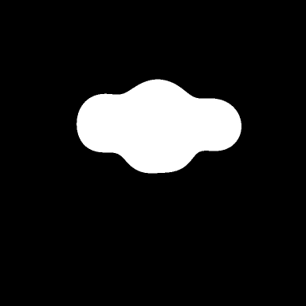
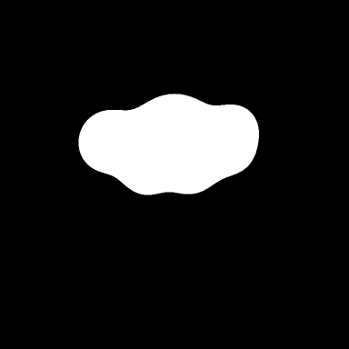

# Adaptive motion admission

`motion auto on` opts into directional admission in `morph-lab`.
`motion auto off` restores strict admission. Every runtime starts strict; the
existing config and original live command grammar remain unchanged. Presets
are deferred to keep this change focused.

Type `morph cloud`, then `motion auto on`, then `up`. The original directional
strength and duration grammar still applies: requested strength 0.05–0.30 world
units, transition 0.5–10 seconds. A feasible request is accepted unchanged.
Otherwise the runtime searches for a feasible translation endpoint before
committing any channel. Shape, squash/stretch, wander and duration are preserved.
Other commands retain strict behavior, including shape changes.

## Selection and limits

Let `p` be the currently admitted translation endpoint, `q` the requested
endpoint, and `alpha` the search fraction. The candidate endpoint is
`p + alpha*(q-p)`, for `alpha` in `[0,1]`. Its blend starts at the current
translation value, preserving continuity during supersession. The search uses
the old endpoint as its origin, rather than accumulating another directional
impulse. Consequently repeated requests at a saturated endpoint reject honestly.

The existing conservative admission calculation checks every combination of
shape, translation and squash/stretch endpoints against per-element force and
displacement limits, enclosing wander by its existing analytic box. It accepts
only if every corner passes. With all other channels fixed, each constraint is
a norm of an affine function of `alpha`, hence convex. The new start lies in the
old admitted translation segment. At zero, the previous endpoint is retained;
feasibility on `[0,1]` is therefore an interval containing zero. This justifies
bisection, including transitions between different directions.

First test the requested endpoint exactly. If it fails, verify zero is feasible,
then take 48 fixed bisection iterations, keeping the feasible lower endpoint.
The final interval width is `2^-48`; this is a deterministic finite search, not
an exact real-number maximizer. Reject if the accepted endpoint differs from
`p` by less than `1e-6` world units. This threshold defines meaningful target
movement; it does not claim human perceptibility. No speed tuning, fallback
shape, wander toggle, clamp, numerical threshold change or state repair occurs.

An effective component may be below the historical command minimum 0.05; only
the new event version can represent that decision. An interrupted turn between
directions can retain some prior-axis offset. Feedback includes the full XY
target so that it is clear what was accepted. The endpoint remains on the
bounded segment between prior and requested targets, never extrapolates, and
its norm is at most the larger endpoint norm. The fraction measures progress
along that segment, not speed or a fraction of the current physical position.

Admission bounds target forces and offsets, following Build 0.2's contract.
It does not replace integration guards or prove every dynamic trajectory valid
under arbitrary configurations. For example, a custom displacement limit exactly
at the admitted equilibrium can still be exceeded by spring overshoot. The
unchanged step guard rejects such a candidate without committing it. Slowing a
transition does not make an unsafe final force acceptable.

## Recording compatibility

Original `cz-live-event-0.1`, `cz-morph-event-0.1` and their schemas are unchanged.
An old morph motion event always means strict admission, even when replayed
after an opt-in event. The new `cz-morph-event-0.2` supports only:

- `motion_auto`: explicit boolean mode toggle.
- `adaptive_motion`: normalized creator request, full effective translation,
  selected fraction, and algorithm identifier `translation-bisection-v1`.

Replay recomputes the decision under the supported recorded environment and
requires exact canonical agreement before applying the stored effective value.
Malformed, altered or inconsistent decisions reject without state mutation.
Sessions containing these events use `cz-morph-session-0.2`, which can also
contain original 0.1 events. Original 0.1 sessions reject extended events. Takes
without opt-in commands continue to use the original session format. The
running marker remains the existing incomplete marker; it cannot replay.

Existing source/environment provenance checks remain intact. Historical takes
retain their meaning and require their matching original engine source and
environment for exact verification, as before. This change does not bypass
provenance to make an older take appear compatible with new source.

## Reproduce the demonstration

From the repository root in the locked Python 3.12 environment:

```sh
python scripts/demo_adaptive_motion.py --out outputs/adaptive_take_01 --render
commander-zorg verify-morph-session outputs/adaptive_take_01/record/session.json
commander-zorg verify-morph-export outputs/adaptive_take_01/video/manifest.json
```

Use a new directory each time. Open `outputs/adaptive_take_01/video/player.html`
for all 270 PNG frames at 30 FPS. MP4 is explicitly disabled. The script records
nine seconds with cloud and wander active, captures before and after, applies
`up` at tick 180, verifies all 541 states and exact replay, then verifies export.
The [recorded report](adaptive-evidence/report.json) contains the actual request,
applied value, observed maxima and verification results. The self-contained
[session](adaptive-evidence/session.json) preserves config, events, source and
environment hashes; regenerate on another environment rather than altering it.

| Before movement (tick 180) | After movement (tick 538) |
| --- | --- |
|  |  |

## MacBook acceptance

```sh
git fetch origin
git checkout feature/adaptive-motion
python3.12 -m venv .venv
source .venv/bin/activate
python -m pip install -r requirements.lock
python -m pip install --no-deps --no-build-isolation -e .
python -m pytest -q
commander-zorg morph-lab --record outputs/adaptive_mac_01 --mono
```

In Terminal.app or iTerm2, enter `morph cloud .5`, wait for it to settle, then
`up`. Confirm strict rejection and continuing animation. Enter `motion auto on`,
then `up`. Confirm adaptive acceptance, requested/applied values and preserved
cloud/wander. With this default geometry the applied Y target is approximately
0.0744372057. After settling, repeat `up`; confirm truthful rejection because
no meaningful progress remains. Enter `motion auto off`, then `up`; confirm
strict rejection again. Try invalid strength `up .31` and confirm no jump.

Capture with `capture mac_cloud`, then `save`; inspect all exported frames and
run `verify-morph-session` and `verify-morph-export` on the local take. Repeat a
separate take with Ctrl+C, and verify terminal echo, cursor and alternate screen
restoration. Resize the terminal and check feedback remains visible at ordinary
sizes; very small viewports retain the existing truncated-status behavior.
Record native macOS test and terminal results separately. Exact cross-platform
image identity and creator artistic approval are not asserted by Linux results.
