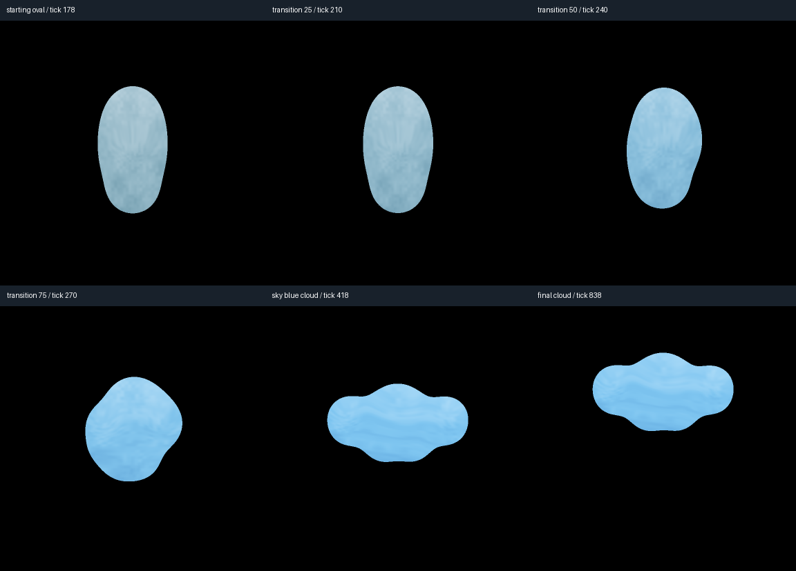

# Reproducible oval to sky-blue cloud

```sh
python scripts/demo_chromatic_cloud.py --out outputs/chromatic_cloud_01
commander-zorg verify-morph-session outputs/chromatic_cloud_01/record/session.json
commander-zorg verify-morph-export outputs/chromatic_cloud_01/video/manifest.json
```

Use a fresh directory. Seed172026; unchanged 384px mathematical raster;
60Hz simulation, 30FPS export. The complete take includes three seconds of
setup because historical runtime initialization starts from home: `morph oval .5`
and `wander off` settle before the main oval capture at tick178. The full source
recording retains this setup rather than inventing an unrecorded initial state.
Main cloud morph starts at tick180 and uses exactly120ticks/two seconds. Palette
follows the quintic target timeline; the existing spring geometry settles later.

Color auto is enabled; normal intensity requests0.20 up at tick420. Bold intensity
then requests0.30 at tick600 and adapts to approximately0.23353747. Repeating at
tick780 reports LIMIT REACHED without event/channel/state mutation. Final cloud
capture is tick838. The report preserves exact normalized requests, effective
endpoints, feedback and rejection evidence.

Verified **841 states /420 RGB frames /5 captures**, exact replay and RGB export
integrity. Every committed state passes original guards. FFprobe confirms420
H.264/yuv420p frames at30FPS. Repeated sampled RGB renders are identical; seed,
palette algorithm, event timing and current source/environment are embedded.
Independent review decoded all420frames and found maximum adjacent whole-frame
mean absolute change0.627/255, with coherent blue endpoint means around
RGB134,199,240. These are descriptive observations, not a universal flicker or
artistic acceptance threshold. Grayscale baseline has independent pinned hashes.



Compact report/session/events and samples are committed in `studio-evidence/`.
Regenerate the full local PNG/HTML/MP4 sequence with the command above, or use the
provided downloadable complete demonstration. Player.html opens locally from its
folder. The artifact manifest indexes every export file and exact verification
regenerates frames; source/environment changes correctly refuse exact replay.

Creator artistic acceptance remains **pending**. Review silhouette, sky-blue
coherence, texture, timing and terminal appearance before approving the artwork.
Rigid scene/world travel remains a separately recommended engineering pass.
